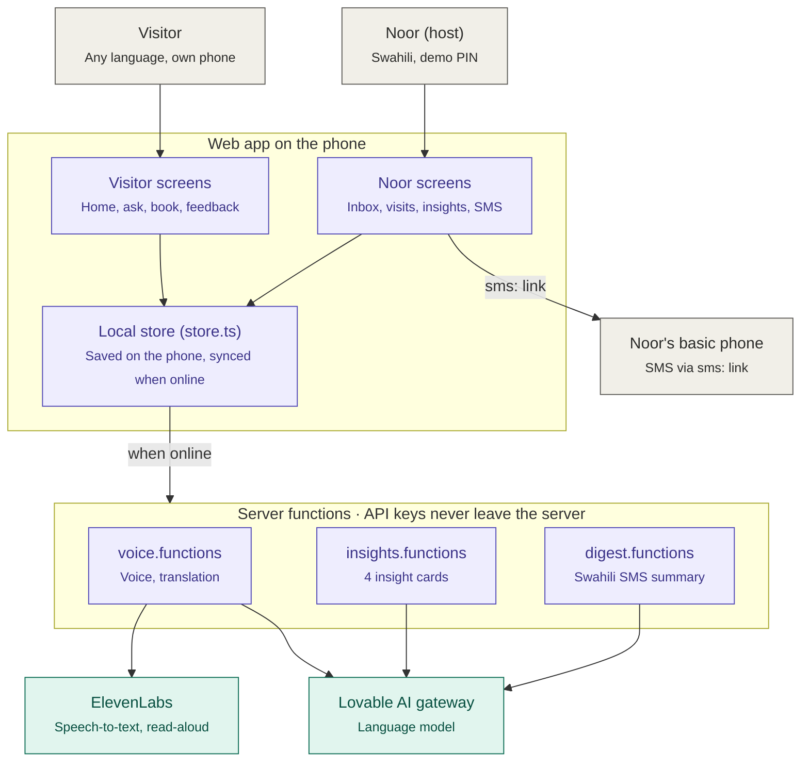

# Roots & Routes

**Meet Noor. Experience coffee from the people who grow it.**

Roots & Routes helps a smallholder coffee farmer host travellers from anywhere in the world, in her own language, from the phone she already has.

**Live app:** https://rootsandroutesnoor.lovable.app

---

## 1. Problem statement

Because of Roots & Routes, **Noor, a Swahili-speaking coffee farmer with a basic phone**, will **answer visitors' questions, accept visit requests and act on their feedback within a day**, which she would otherwise **not do at all**, because she doesn't share a language with her visitors and has no smartphone or steady signal.


---

## 2. AI capabilities

### What the AI does

| Noor already does this | AI does this around her | Type of AI |
|---|---|---|
| Speaks Swahili | Translates messages both ways between Noor and visitors (7 visitor languages) | Language, generative |
| Records voice replies | Turns voice into text (speech-to-text) | Machine learning (speech) |
| Listens | Reads translations aloud, always labelled as a narrator | Generative voice |
| Reads a text message | Summarises all visitor feedback into one short Swahili SMS | Language, generative |
| Taps big buttons | Turns feedback into 4 simple cards, each with 1 small action to try | Language, generative |

Noor doesn't need a new phone, a new app or new skills. The AI adapts to her.

### Why a simpler tool can't do the same job

- **Plain SMS** can reach Noor, but it can't translate a Spanish review into Swahili or summarise 50 comments.
- **A spreadsheet** can store feedback, but it can't tell Noor what visitors keep asking for.
- **A translate app** is one-way, sits outside the conversation, can't be checked before sending, and doesn't reach a basic phone.

### Guardrails

- **Her real voice:** Noor's recordings are never replaced by a synthetic voice. Read-aloud is used only for translations and is labelled.
- **Human review:** Noor's translated replies wait for her or her family to confirm before the visitor sees them ("Translation is right — send" / "This isn't what I meant").
- **No invented data:** the AI uses only the feedback it's given, with real quotes and real counts.
- **Kept separate:** what visitors said is shown apart from AI suggestions.
- **Flags uncertainty:** low-confidence translations are marked "may not be exact".
- **Consent and privacy:** the AI reads feedback only if the visitor agrees, and no names or contact details go into the AI or the SMS.
- **Labelled:** everything AI-made says "AI".
- **Safe setup:** all AI calls run on the server, so API keys never reach the phone.

---

## 3. The challenge and the gap

### The gap

| Barrier | Today | With Roots & Routes |
|---|---|---|
| Language | Visitors can't speak Swahili | Two-way AI translation |
| Device | Most apps need a smartphone | Swahili SMS on any phone |
| Signal | Farm signal is patchy | Saved on the phone, synced later |
| Feedback | Reviews never reach Noor | Simple cards, one action |
| Middlemen | Agents speak for the farmer | Direct requests, in her own voice |

### Where it sits in Noor's day

1. **Morning:** a visitor scans the QR code at the farm gate, explores the farm and asks Noor a question in their own language.
2. **Midday:** Noor opens the app, listens to the question in Swahili and replies in her own voice. She confirms the translation, and the visitor sees the reply.
3. **Afternoon:** she accepts a visit request, or suggests another day.
4. **Evening:** a short Swahili text arrives on her basic phone: how many visitors wrote and what they said. No app needed.
5. **Weekly:** she checks the insight cards and picks one small thing to try, such as "Show guests how you roast coffee".

**What happens next:** visitors get answers and confirmed visits, and Noor earns directly and improves her farm visits from real feedback.

---

## How it works



<sub>Purple: our code · Teal: external AI service · Gray: people and devices</sub>

1. A visitor asks a question on their phone. It's saved on the device first, so nothing is lost without signal.
2. When online, a server function sends it to the AI to be translated into Swahili. API keys stay on the server.
3. Noor reads or listens to it and replies. Her reply is translated back and checked before the visitor sees it.
4. Visitor feedback becomes insight cards and a short Swahili SMS, sent to Noor's basic phone from the phone's own messages app.

## Tech stack

- **App:** React and TypeScript (TanStack Start), Tailwind CSS, shadcn/ui
- **AI:** a language model through the Lovable AI Gateway (translation, insights, SMS summary) and ElevenLabs (speech-to-text, read-aloud)
- **Offline-first:** data is saved on the device and synced when signal returns
- **SMS:** sent through the phone's own messaging app, with no paid SMS service

## Run locally

```sh
npm i
npm run dev
```

> Prototype note: farm details, prices and some photos are placeholders until Noor confirms them. The host PIN is a demo, not real security.
